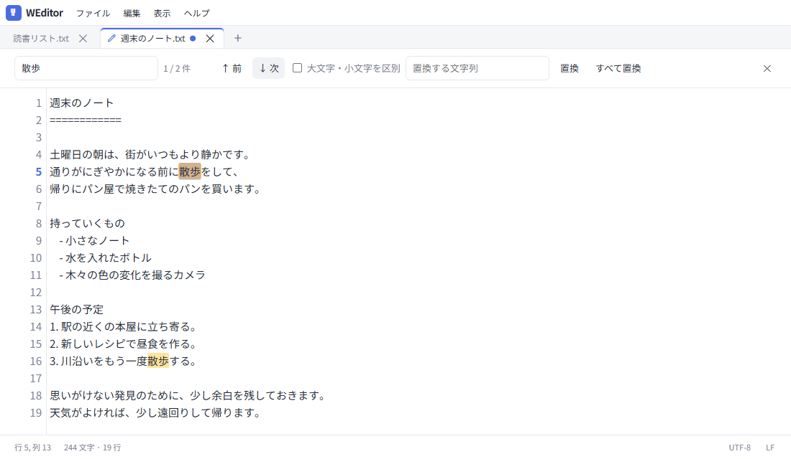
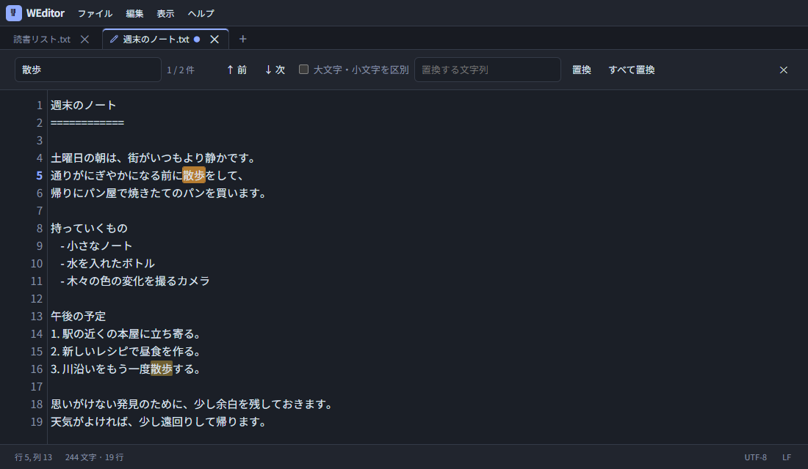

# WEditor

[English](README.md) | **日本語**

ローカルで動く、単一HTMLのテキストエディタです。ブラウザの優先言語が日本語なら日本語、それ以外なら英語で開きます。表示メニューからも切り替えられます。

## スクリーンショット

サンプル文章「週末のノート」を入力した実際の画面です。

### ライトモード



### ダークモード



## 使い方

`dist/weditor.html` をブラウザで開いてください。このファイルだけを任意のディレクトリにコピーして使えます。サーバー、インストール、ネット接続は不要です。Noto Sans JPのフォントもHTMLに埋め込んでいます（HTML全体は約7.0 MiB）。

- タイトルと「ファイル・編集・表示・ヘルプ」メニューを1行に配置し、直下にタブと編集領域を表示
- 複数タブ、新規ファイル、複数ファイルの読み込み、ドラッグ＆ドロップ
- 新規はUTF-8、既存ファイルの文字コードを保持して読み込み・保存、名前を付けて保存
- 行番号、行・列位置、文字数、行数
- Enterで半角空白・全角空白・タブを含む行頭のインデントをそのまま保持
- `-`／`*`／`+`や`1.`／`1)`の箇条書きをEnterで継続（番号は自動加算、途中に行を挿入すると同じインデント・記号の連続した後続項目を振り直し）
- 空の箇条書き項目でEnterを押すと終了。Shift+Enterは記号を追加せずインデントだけを保持して改行
- Tab／Shift+Tabで選択行に4スペースのインデント／解除
- 文字列検索、全一致箇所のハイライト、前後移動、大文字小文字の区別、置換・すべて置換
- 選択中のタブはペン、未保存の変更はタブの●で表示
- タブごとの元に戻す／やり直す、変更破棄・ページ離脱時の確認
- 表示メニューで通常／ダーク、日英、文字サイズ変更（11～28px）と「標準に戻す」（15px）

Chrome／EdgeなどFile System Access APIに対応したブラウザでは、ユーザーが選択したファイルへ直接保存できます。非対応のブラウザでは、保存用ファイルをダウンロードします。ダウンロード時にタブの●が消えても、ブラウザのダウンロード完了・保存先は確認してください。ダウンロードしたファイルを読み込めます。

新規ファイルはUTF-8・BOMなしで、WindowsならCRLF、それ以外（macOS／Linuxなど）ならLFで保存します。OSはブラウザが提供するプラットフォーム情報で判定します。開いたファイルの文字コード、UTF-8／UTF-16のBOMとLF／CRLFは保持し、右下のLF／CRLFボタンで改行形式を切り替えられます。混在した改行は選択した形式に統一します。対応文字コードはUTF-8、Shift_JIS（CP932）、EUC-JP、ISO-2022-JP、UTF-16LE／BE（BOM付き）です。UTF-8とBOM付きUTF-16を優先判定し、その他は候補が1つに絞れる場合だけ開きます。判定不能・複数候補・不正なデータは、対応文字コードを記載したエラーメッセージを表示して開きません。文字コード指定メニューや確認ダイアログはありません。ASCIIだけのファイルはUTF-8として開きます（多くの文字コードでバイトが共通です）。UTF-16として判定するのはBOM付きのファイルだけです。保存時に元の文字コードで表せない文字がある場合は保存を中止して通知します。

文字サイズと、表示メニューで明示的に選んだ言語・テーマをブラウザのlocalStorageへ記録します。自動判定された値やURL指定だけでは言語・テーマの保存値を書き換えません。本文やファイル名は保存しません。ブラウザを閉じた後の復元機能はありません。localStorageが利用できない環境でも編集できます。`file://`での保存領域はブラウザに依存し、HTMLを移動・改名した場合に設定が引き継がれる保証はありません（[MDN](https://developer.mozilla.org/en-US/docs/Web/API/Window/localStorage)）。ブラウザのサイトデータを削除すると、手動指定が消えて自動判定に戻ります。

## 起動時の言語・テーマ指定

通常はブラウザの優先言語（`navigator.languages`の先頭、なければ`navigator.language`）と、OS／ブラウザの配色設定（`prefers-color-scheme`）で表示を決めます。日本語ロケールは日本語、その他は英語になります。

URLのクエリパラメータで個別に上書きできます。

| パラメータ | 値               | 意味                      |
| ---------- | ---------------- | ------------------------- |
| `lang`     | `ja` / `en`      | 日本語 / 英語             |
| `theme`    | `dark` / `light` | ダークモード / 通常モード |

例：`file:///D:/tools/weditor.html?lang=ja&theme=dark`。片方だけの指定も可能で、表示は「有効なURL指定 → 保存済みの手動選択 → OS／ブラウザ設定」の順で決まります。不正な指定は無視します。外部サーバーへリクエストを送る機能ではありません。

保存済みの手動選択とURL指定がない項目は、起動後もOS／ブラウザ設定の変更に追従します。メニューでは「自動」を表示せず、実際に使われている言語・テーマに✓を表示します。手動切替をするとその項目は自動追従を終了し、次回も選択を復元します。URL指定はその起動だけの上書きです。ヘルプメニューには「キーボードショートカット」と「WEditorについて」があります。

メニューはクリック、Enter／Spaceで開けます。上下矢印・Home／Endで項目を選び、Escで閉じられます。項目を実行したり編集領域を選択したりするとメニューは閉じます。

## ショートカット

| 操作                   | キー                          |
| ---------------------- | ----------------------------- |
| 新規                   | Ctrl+Alt+N                    |
| 開く                   | Ctrl+O                        |
| 保存／名前を付けて保存 | Ctrl+S／Ctrl+Shift+S          |
| 検索・置換             | Ctrl+F／Ctrl+H                |
| 次／前の検索結果       | F3／Shift+F3                  |
| 元に戻す／やり直す     | Ctrl+Z／Ctrl+Shift+Z、Ctrl+Y  |
| インデント／解除       | Tab／Shift+Tab                |
| 文字サイズ変更         | Ctrl+＋／Ctrl+−、表示メニュー |
| 標準に戻す             | Ctrl+0、表示メニュー          |
| 次／前のタブ           | Alt+→／Alt+←                  |
| 検索を閉じる           | Esc                           |

macOSではCtrlの代わりにCommandも利用できます（macOS実機での動作検証は未実施です）。ブラウザ・OSが予約するショートカットはメニューボタンで代替できます。日本語IMEの変換中はEnterやショートカットを横取りしません。

## 開発

Node.js 24以降を推奨します。

```sh
npm ci
npm run build
```

`dist/weditor.html` を生成します。文字コード変換ライブラリもHTMLへ埋め込むため、実行時の外部依存ファイルはありません。依存関係のバージョンはpackage-lock.jsonで固定します。

```sh
npm run check   # 整形確認・型検査・ビルド・テスト
npm run format  # ソース・文書の整形
npm audit       # 依存関係の既知の脆弱性確認
```

Windowsのテストはインストール済みMicrosoft Edge、Linux/macOSとCIはPlaywrightのChromiumを使い、`file://`で最終HTMLを開きます。Linux/macOSでは事前に`npx playwright install chromium`を実行してください。`PW_BROWSER`と`PW_CHANNEL`でブラウザを指定できます。詳細は[貢献ガイド](CONTRIBUTING.md)を参照してください。CI設定は追加済みですが、GitHub上での実行結果は公開前に確認してください。

| ファイル                  | 役割                                               |
| ------------------------- | -------------------------------------------------- |
| src/app.ts                | 編集操作、タブ、ファイル操作、画面更新             |
| src/types.ts              | 型定義、DOM参照、ファイルAPI定義                   |
| src/environment.ts        | 言語・配色・改行形式の自動判定、URL指定            |
| src/i18n.ts               | 日英メニュー・メッセージ                           |
| src/encoding.ts           | 文字コード判定・厳密な読み書き・保存時の欠落検証   |
| src/search.ts             | 検索処理と件数制限                                 |
| src/text.ts               | 行位置の計算、選択範囲を保持するインデント処理     |
| src/safety.ts             | ファイル名処理、設定JSONの形式検証                 |
| src/limits.ts             | フォント・ファイル・文書・履歴の上限と文書量の判定 |
| src/history.ts            | 両方向の履歴とメモリ上限                           |
| src/settings.ts           | 表示設定の読み書きと許容値の検証                   |
| src/file-storage.ts       | バイト列の保存・失敗時中断・ダウンロード           |
| src/menus.ts              | メニューのキーボード操作とフォーカス               |
| src/styles.css            | テーマ、レイアウト、エディタとハイライトの共通書式 |
| src/template.html         | 画面構造                                           |
| scripts/build.mjs         | バンドル、フォント埋め込み、CSPハッシュ生成        |
| tests/editor.spec.ts      | 実際の最終HTMLを使う操作・保存・防御テスト         |
| tests/environment.spec.ts | OS設定・URL指定・改行コード・機能削除の検証        |

配布HTMLの手編集はCSPハッシュと一致しなくなるため、ソースを修正して再ビルドしてください。

## 防御と制限

- CSPはビルドしたJS／CSSのSHA-256ハッシュだけを許可します。外部通信、外部画像、プラグイン、フォーム送信、インラインイベント、evalは許可しません。フォントは埋め込みdata URLだけを使います。
- ファイル本文とファイル名はテキストとして表示します。本文をHTMLとして解釈したりプレビュー・実行したりしません。
- UTF-8／UTF-16の厳密な復号と、日本語文字コードの往復変換を検証します。不正なバイト列や本文中のNULなどの制御文字を拒否し、保存前に文字の欠落・置換がないことを確認します。ファイルは10 MiBまでです。
- 検索はリテラル文字列だけを扱います。ハイライトは10,000件まで。超過時は部分的な「すべて置換」を実行せず通知します。
- タブは32個まで。本文と保存済み本文・保存待ちスナップショットの合計は、UTF-16文字列の概算容量で64 MiBまでです。上限を超える新規作成・読み込み・編集は拒否します。
- undoとredoを合わせた履歴はタブごとに300件・概算16 MiBを目安に古いものを削除し、全タブ合計は64 MiB以内に保ちます。1件の大きな履歴はタブ単位の目安を超えて保持する場合があります。行番号は画面付近だけを描画します。
- 本文は10 Mi文字まで、検索文字列は1,000文字まで、置換文字列は10,000文字までです。上限を超える置換は実行しません。
- ダウンロードファイル名のパス区切り、制御文字、Windows予約名を処理します。設定は形式と許容値を検証し、本文を永続化しません。

CSPはこのエディタ内での実行・通信を制限するための防御です。配布HTMLそのものを改変できる第三者に対する署名・真正性の保証や、端末上のファイル暗号化は提供しません。

## ライセンス

アプリは[MITライセンス](LICENSE)です。アプリ本体のライセンス通知も生成HTMLに埋め込みます。[Noto Sans JP](https://fontsource.org/fonts/noto-sans-jp/about)はSIL Open Font License 1.1です。`licenses/NotoSansJP-OFL.txt` と生成HTML内にライセンスを含めています。

文字コード変換には[encoding.js](https://github.com/polygonplanet/encoding.js)（MIT）を利用します。`licenses/encoding-japanese-MIT.txt` と生成HTML内にライセンスを含めています。

## ブラウザと検証範囲

ローカル検証はWindowsのMicrosoft Edgeで実施しています。File System Access APIがないブラウザは読み込み用のファイル選択と保存用ダウンロードに切り替わります。Firefox/WebKit用のテスト設定もありますが、実行していない組み合わせまで対応確認済みとはしていません。

配布HTMLは約7.0 MiBで、大部分がオフライン用の日本語フォントです。起動・編集速度はブラウザ、端末、文書サイズに依存します。UTF-8として有効なデータは優先して開きますが、文字コードの自動判定は完全ではありません。CP932の重複マッピングは文字を保持しつつバイト表現が変わる場合があり、冗長なISO-2022-JP表現などは検証で拒否されることがあります。

[貢献ガイド](CONTRIBUTING.md)、[セキュリティ方針・報告方法](SECURITY.md)を用意しています。

## スクリーンショットの更新

```sh
npm run build
npm run screenshots
```

`scripts/screenshots.mjs`が`docs/samples/`のサンプル文章を使用し、最終HTMLをEdge／Chromiumで開いて日英・ライト／ダークの4枚を撮影します。画像は`docs/screenshots/`へ保存され、配布HTMLには含まれません。
