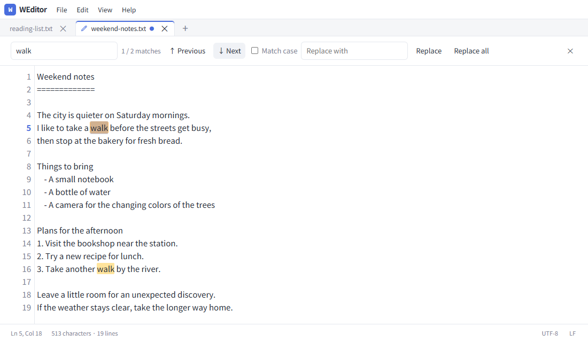
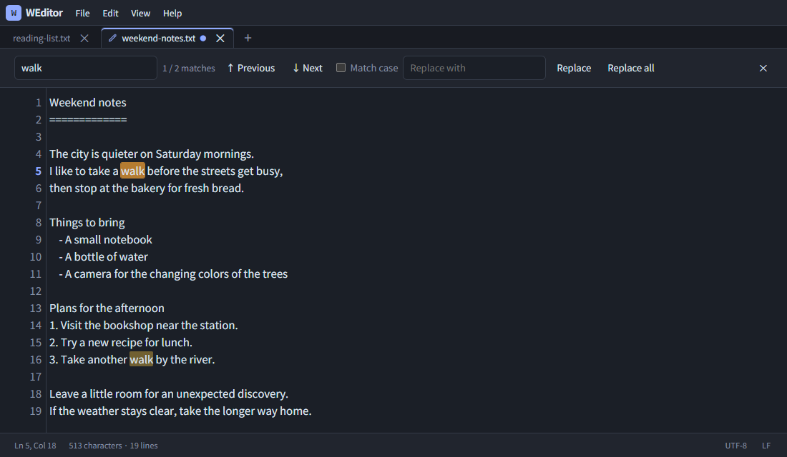

# WEditor

**English** | [日本語](README.ja.md)

An offline text editor in a single HTML file. Open it in your browser from any directory. No installation, server, or network connection is needed.

## Screenshots

The actual editor displaying a sample document, “Weekend notes.”

### Light mode



### Dark mode



## Getting started

Open [dist/weditor.html](dist/weditor.html) in your browser. Copy this file alone to any directory to use it there. Noto Sans JP and the encoding library are embedded. The complete HTML is approximately 7.0 MiB.

- Compact File, Edit, View, and Help menus beside the app title, with tabs and the editor immediately below.
- Multiple tabs, new documents, opening multiple files, and drag and drop.
- UTF-8 for new files; existing files retain their detected encoding when saved. Save and Save As are available.
- Line numbers, line/column position, character count, and line count.
- Enter preserves leading spaces, full-width spaces, and tabs.
- Enter continues `-`, `*`, `+`, `1.`, and `1)` lists. Inserting a numbered item renumbers consecutive following items with the same indentation and delimiter.
- Enter on an empty list item ends the list. Shift+Enter inserts a line break with indentation but no list marker.
- Tab and Shift+Tab indent or unindent selected lines using four spaces.
- Literal search, highlighting, next/previous matches, case sensitivity, replacement, and Replace All.
- A pen marks the active tab; a dot marks unsaved changes.
- Per-tab undo/redo and confirmation before discarding changes or leaving the page.
- Light/dark themes, English/Japanese menus, font sizes from 11 to 28 px, and Reset size to restore the default 15 px.

Browsers with the File System Access API, such as Chrome and Edge, can save directly to a file you select. Other browsers download a copy. When the unsaved dot disappears after a download starts, check the browser's download completion and destination. Downloaded files can be opened again.

## Encodings and line endings

New files use UTF-8 without a BOM. Their default line ending is CRLF on Windows and LF on other platforms, based on information provided by the browser.

Supported encodings:

- UTF-8
- Shift_JIS (CP932)
- EUC-JP
- ISO-2022-JP
- UTF-16LE and UTF-16BE with a BOM

UTF-8 and BOM-marked UTF-16 take priority during detection. Other encodings are accepted only when there is exactly one valid candidate. Unidentified, ambiguous, or invalid files are rejected with an error listing the supported encodings. There is no manual encoding menu or confirmation dialog. ASCII-only files are opened as UTF-8 because their bytes are shared by several encodings. UTF-16 is recognized only with a BOM.

The detected encoding, UTF-8/UTF-16 BOM, and LF/CRLF line ending are preserved. Use the LF/CRLF button at the bottom right to change line endings. Mixed endings are normalized to the selected format. If the encoding cannot represent a character, saving stops with an error instead of silently replacing it.

Detection cannot be perfect. Valid UTF-8 takes priority even if another encoding could interpret it. CP932 duplicate mappings may be normalized to different bytes while retaining the same characters. Some redundant ISO-2022-JP byte sequences are rejected by round-trip validation.

## Language, theme, and preferences

The editor uses Japanese when the browser's first preferred language is Japanese, and English otherwise. Its initial theme follows the OS/browser color scheme.

Startup priority: **valid URL parameter → saved manual choice → OS/browser preference**.

| Parameter | Values           | Meaning            |
| --------- | ---------------- | ------------------ |
| `lang`    | `ja` / `en`      | Japanese / English |
| `theme`   | `dark` / `light` | Dark / light theme |

Example: `file:///D:/tools/weditor.html?lang=en&theme=dark`. Either parameter can be specified independently. Invalid values are ignored. Parameters are handled locally and do not send requests to a server.

The View menu checks the language and theme currently in use, without an Auto item. Settings with no URL override or saved manual choice continue to follow OS/browser changes. A manual choice stops automatic following for that setting and is restored next time. URL overrides apply only to that launch and do not replace saved manual choices.

Font size and explicit language/theme choices are stored in localStorage. Automatically detected language/theme values are not saved as manual choices. Document contents, filenames, and file handles are not persisted. Documents are not restored after closing the browser. Editing still works when storage is unavailable.

For `file://` URLs, storage behavior depends on the browser; moving or renaming the HTML may prevent preferences from carrying over. Clearing its browser storage removes manual choices and restores automatic selection. See [MDN's localStorage documentation](https://developer.mozilla.org/en-US/docs/Web/API/Window/localStorage).

Menus open with a click or Enter/Space. Use Up/Down, Home/End, and Escape to navigate or close them. Executing an action or focusing the editor closes the menus. Help contains Keyboard shortcuts and About WEditor.

## Keyboard shortcuts

| Action                        | Shortcut                      |
| ----------------------------- | ----------------------------- |
| New document                  | Ctrl+Alt+N                    |
| Open                          | Ctrl+O                        |
| Save / Save As                | Ctrl+S / Ctrl+Shift+S         |
| Find and replace              | Ctrl+F / Ctrl+H               |
| Next / previous match         | F3 / Shift+F3                 |
| Undo / redo                   | Ctrl+Z / Ctrl+Shift+Z, Ctrl+Y |
| Indent / unindent             | Tab / Shift+Tab               |
| Increase / decrease font size | Ctrl+Plus / Ctrl+Minus        |
| Reset size                    | Ctrl+0                        |
| Next / previous tab           | Alt+Right / Alt+Left          |
| Close search                  | Escape                        |

Command can replace Ctrl on macOS, although macOS hardware has not been tested. Browser/OS shortcuts may take precedence; use the menus when necessary. Enter and shortcuts are not intercepted during Japanese IME composition.

## Development

Use Node.js 24 or newer.

```sh
npm ci
npm run build
```

The build generates `dist/weditor.html`, including fonts, the encoding library, and license notices. There are no external runtime files. Dependency versions are pinned in `package-lock.json`.

```sh
npm run check   # Formatting, type checking, build, and tests
npm run format  # Format source and documentation
npm audit       # Check dependencies for known vulnerabilities
```

Tests open the final HTML using `file://`. Windows defaults to installed Microsoft Edge; Linux/macOS and CI use Playwright's Chromium. Install it with `npx playwright install chromium` before testing on Linux/macOS. `PW_BROWSER` and `PW_CHANNEL` select another browser. See the [contributing guide (Japanese)](CONTRIBUTING.md).

| File or directory         | Responsibility                                       |
| ------------------------- | ---------------------------------------------------- |
| `src/app.ts`              | Editor UI, tabs, rendering, and action orchestration |
| `src/types.ts`            | Types, DOM references, and file API definitions      |
| `src/environment.ts`      | Startup language, theme, platform, and URL settings  |
| `src/i18n.ts`             | English and Japanese messages                        |
| `src/encoding.ts`         | Detection, decoding, encoding, and loss checks       |
| `src/search.ts`           | Literal search and result limits                     |
| `src/text.ts`             | Indentation, list continuation, and line positions   |
| `src/safety.ts`           | Filename and settings JSON validation                |
| `src/limits.ts`           | Resource limits and document-size accounting         |
| `src/history.ts`          | Undo/redo and history budgets                        |
| `src/settings.ts`         | Reading and writing display preferences              |
| `src/file-storage.ts`     | Byte writes, aborting failed writes, and downloads   |
| `src/menus.ts`            | Menu keyboard and focus behavior                     |
| `src/styles.css`          | Layout, themes, and shared text/highlight styling    |
| `src/template.html`       | UI structure                                         |
| `scripts/build.mjs`       | Bundling, embedded assets, CSP hashes, and output    |
| `scripts/screenshots.mjs` | README screenshot generation                         |
| `tests/`                  | Final-HTML behavior and pure-logic regression tests  |

Change the source and rebuild. Editing the distributed HTML directly invalidates its CSP hashes.

## Security and resource limits

- CSP permits only the built JavaScript and CSS hashes. External communication, external scripts/images, plugins, form submissions, inline event handlers, and eval are blocked. Fonts use embedded data URLs.
- File contents and names are rendered as text, never interpreted as HTML or executed.
- Strict Unicode decoding and Japanese encoding round trips reject invalid data and binary controls such as NUL. Saving checks for character loss first. Files are limited to 10 MiB.
- Search treats input as literal text. Highlighting is limited to 10,000 matches; Replace All is refused when the complete result exceeds that limit.
- Up to 32 tabs are allowed. Current text, saved originals, and pending-save snapshots share a 64 MiB approximate UTF-16 string budget. Operations that exceed these limits are refused.
- Undo and redo share a per-tab target of 300 entries and approximately 16 MiB. A single large snapshot may exceed the per-tab target. All tabs together are limited to 64 MiB of history. Older snapshots are discarded, and only nearby line numbers are rendered.
- Documents are limited to 10 Mi UTF-16 code units, search input to 1,000, and replacement input to 10,000. Oversized replacements are refused.
- Download filenames are sanitized, settings are validated, and document contents are not persisted.

CSP protects execution and communication within the editor. It does not authenticate HTML modified by a third party or encrypt device files. Budgets do not strictly bound total browser memory or temporary encoding allocations. See the [security policy and reporting guide (Japanese)](SECURITY.md).

## Browser verification and file size

Local verification has been performed on Windows/Microsoft Edge. Browsers without the direct file API fall back to file selection and downloads. Firefox/WebKit test settings are available, but untested combinations are not considered verified. GitHub CI configuration is included; its actual result must be checked after running it on GitHub.

The approximately 7.0 MiB HTML is mostly the Japanese font needed for offline use. Startup and editing speed depend on the browser, device, and document size.

## Updating screenshots

```sh
npm run build
npm run screenshots
```

`scripts/screenshots.mjs` opens the final HTML in Edge/Chromium with sample documents from `docs/samples/`. It captures English/Japanese light/dark screenshots in `docs/screenshots/`. These documentation PNGs are not embedded in the distributed editor.

## License

WEditor is licensed under [MIT](LICENSE); its notice is also embedded in the generated HTML.

[Noto Sans JP](https://fontsource.org/fonts/noto-sans-jp/about) uses the SIL Open Font License 1.1. Its notice is in [licenses/NotoSansJP-OFL.txt](licenses/NotoSansJP-OFL.txt) and the generated HTML.

[encoding.js](https://github.com/polygonplanet/encoding.js) uses MIT. Its notice is in [licenses/encoding-japanese-MIT.txt](licenses/encoding-japanese-MIT.txt) and the generated HTML.
